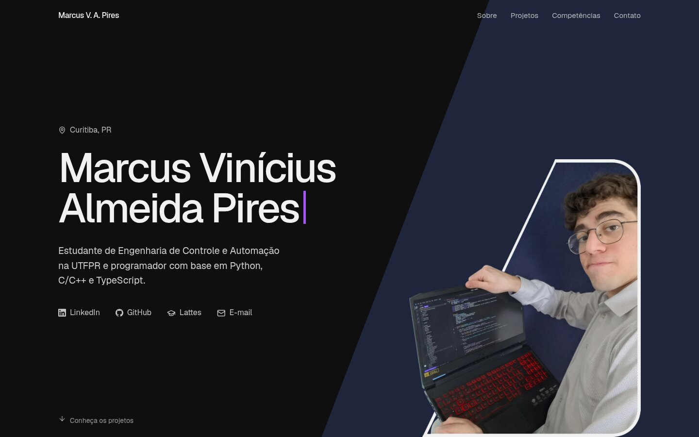

# Site pessoal

Perfil profissional de Marcus Vinícius Almeida Pires. Vite, SolidJS, Tailwind e tema do daisyUI.

<p align="center">
  
  <br>
  <sub>Primeira tela em 07/11/2026.</sub>
</p>

## Rodar

```
nvm use 22
npm install
npm run dev      # http://localhost:3000
npm run build    # saída em dist/
```

## Estrutura

Cada componente é uma pasta com `index.tsx`; os números seguem a ordem da página.

```
src/
  index.tsx, index.css
  inicio/
    01-cabecalho/  02-abertura/  03-sobre/
    04-durante-a-graduacao/  01-projetos-em-destaque/  02-ciframento/  03-radreader/  04-crossbots/
    05-desde-os-13-anos/  06-competencias/  07-contato/
public/
  fotos/  certificados/  media/
```

Conteúdo escrito direto no JSX. Ícones importados um a um (`lucide-solid/icons/<nome>`, `simple-icons/icons/<nome>.svg?raw`).
